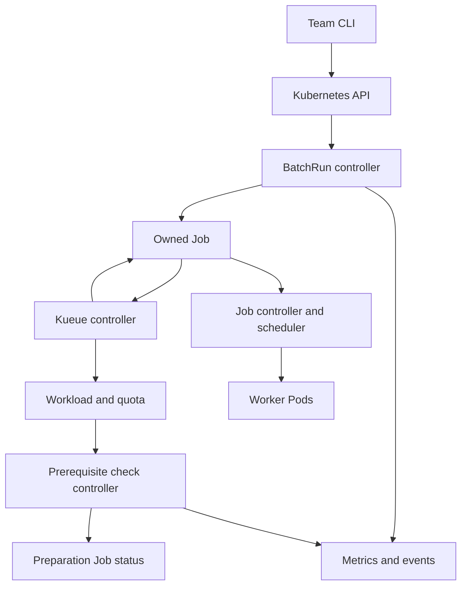

# KubeFleet Complete Codex Build Specification

Go Kubernetes workload operator with Kueue admission and reproducible reliability benchmarks

Prepared for Dhyey Patel. Specification date: September 30, 2026, America/Phoenix. Version: 1.0.

## 1 Purpose and intended outcome

Implement KubeFleet as a complete, reviewable portfolio engineering project for the Apple Services Engineering Compute role, number 200678453-3337. The system must run real Kubernetes Jobs, implement real Go reconciliation logic, integrate real Kueue admission, and include executable tests, operational documentation, and measured experiments. It must be possible for another engineer to clone the repository, reproduce the demonstration, inspect the implementation, and audit every claim.

This document is the implementation contract for Codex. It describes the complete required release scope, architecture, APIs, failure semantics, repository, build sequence, verification, evidence, and handoff. It is a specification, not evidence that the project has already been built. No document or project can guarantee a job offer. The desired outcome is credible evidence of the skills named in the posting, with no invented experience, measurements, or production claims.

The release is complete only when the mandatory acceptance checklist in Section 39 is satisfied with recorded evidence. Optional extensions in Section 40 are deliberately outside that release. An unresolved required feature or environment-blocked test must remain visibly incomplete; Codex must not silently reduce the scope or mark it passed.

## 2 Instructions to the implementing Codex agent

Read this entire document before designing or changing code. First inspect the repository, local instructions, tools, and existing work. Preserve unrelated user changes. Create a persistent implementation plan and requirement traceability matrix. Work sequentially through the milestones below, making the routine technical decisions specified here without repeatedly asking the user to approve them.

Build the project, rather than returning a plan or creating empty scaffolding. Continue through implementation, meaningful verification, fixes, packaging, and documentation. If a future session is required, leave a precise progress checkpoint that allows continuation without repeating completed work.

Do not replace Kubernetes with an in-memory simulator, substitute a generic REST task queue, install Kueue and claim its internals as your implementation, or spend the project budget on a web dashboard. Mocks and fake clients are suitable for selected unit tests only. Required integration and end-to-end evidence must use the real relevant systems.

Do not create placeholder implementations that return success. Do not skip tests to obtain a green pipeline, lower assertions after failures, use sleeps as the sole readiness mechanism, fabricate benchmark results, or call a local cluster a production deployment. Every unexecuted check must be recorded as Not run with the actual blocker.

Use official versioned documentation and source code to resolve integration details. When a pinned upstream version differs from examples in this document, update manifests and adapter code to that version, record the compatibility decision, and preserve the specified behavior. Never copy fields from two different Kueue API versions into the same manifest.

External publishing, cloud provisioning, money spending, sending messages, and upstream pull request submission are not implicitly required by this build document. Prepare reviewable artifacts locally. Provision cloud infrastructure only under explicit user authorization. A local Kubernetes project does not need a hosted website.

### 2.1 Initial prompt to use with this file

Copy the following prompt when attaching this file to Codex:

> Implement the complete mandatory KubeFleet release described in the attached specification. Read the whole file and repository instructions first. Create and maintain the implementation plan, compatibility lock, requirement traceability matrix, and progress checkpoint. Build real Go controllers, Kubernetes CRDs, Kueue integration, CLI, tests, deployment manifests, demonstration scripts, monitoring, and benchmark harness. Complete all mandatory milestones and record actual evidence. Do not stop at scaffolding or a plan. Do not fabricate metrics, quietly skip requirements, or describe unrun tests as passed. Follow the specified ownership, timeout, retry, cancellation, admission, and security semantics. Work locally by default. If the environment blocks a check, complete independent work and record the exact remaining command and blocker. Finish with a reproducible handoff and an honest release checklist.

## 3 Role alignment and portfolio positioning

The supplied Apple posting emphasizes Go proficiency, Kubernetes controllers and infrastructure, Kueue or YuniKorn, cluster efficiency, scalability, availability, production investigation, and upstream engagement. KubeFleet should produce concrete artifacts for each area.

| Role requirement | Required evidence from this project |
| --- | --- |
| Go proficiency | Controllers, CLI, admission evaluator, workload generator, tests, error handling, cancellation, race checks |
| Kubernetes components | CRD schemas, reconciliation, caches and indexes, ownership, conditions, conflict handling, leader election |
| Kueue experience | Jobs integration, LocalQueues, ClusterQueues, cohort borrowing, priority, preemption, custom AdmissionCheck |
| Efficiency | Controlled fixed-quota versus borrowing experiments with identical traces |
| Availability | Controller restart and leader failover tests with no unintended duplicate Jobs |
| Scalability | Separately measured reconciliation load and workload throughput |
| SRE collaboration | Diagnostic CLI, dashboards, alerts, runbooks, failure reports |
| Upstream collaboration | Source investigation notes and a reproducer or contribution proposal based on a genuine finding |

Dhyey's existing Amazon experience provides a foundation in asynchronous workflows, controlled concurrency, retries, failure isolation, monitoring, and deployment. ReplayLab provides a foundation in invariants and crash testing. This project adds direct Go and Kubernetes evidence. Retain those connections in the interview guide without claiming Amazon's system used this architecture.

## 4 Product problem and user journeys

Three engineering teams share a finite Kubernetes worker pool for batch work such as catalog processing, test execution, and model evaluation. Permanent isolation wastes capacity when one team is idle. Uncontrolled sharing allows one team to consume capacity required by others. Engineers also need understandable waiting reasons and dependable behavior after controller failures.

KubeFleet provides a declarative BatchRun API over Kubernetes Jobs and Kueue. Administrators configure queues and capacity policy. Users submit bounded workloads and inspect lifecycle and admission decisions. A prerequisite gate prevents selected workloads from starting before an approved preparation Job succeeds.

Required user journeys:

1. An administrator installs dependencies, CRDs, webhook, operator, team namespaces, queues, workload priorities, and monitoring.
2. A team member validates and submits a BatchRun into an allowed namespace and LocalQueue.
3. The user sees whether the run is waiting for quota, a prerequisite, Pod scheduling, image startup, or execution.
4. A team borrows unused nominal quota from the shared cohort.
5. A permitted higher-priority workload triggers configured Kueue preemption and quota reclamation.
6. A preparation Job succeeds and the admission controller approves its dependent workload.
7. A user cancels a run; resources stop and its result remains inspectable.
8. A controller dies; the replacement continues from Kubernetes state without starting a second logical Job.
9. An engineer diagnoses a stuck workload using the CLI, events, logs, metrics, and runbook.
10. A reviewer executes a deterministic demo and audits raw benchmark evidence.

## 5 Required release scope and exclusions

Mandatory release:

- Go BatchRun lifecycle controller and Go prerequisite AdmissionCheck controller in one manager process.
- Namespaced BatchRun CRD and cluster-scoped PrerequisiteGatePolicy CRD.
- BatchRun validating webhook for immutability and cross-field rules; CRD schema defaults and basic validation.
- Kueue native Kubernetes Job integration, three tenant queues, quota borrowing, workload priorities, and a documented preemption configuration.
- Kubernetes-native leader election with two manager replicas in the reliability profile.
- Go CLI for submit, validate, list, status, wait, cancel, and diagnose.
- Restricted tenant RBAC, admission validation, safe workload defaults, and installation documentation.
- Real unit, envtest, webhook, and kind end-to-end tests.
- Go workload image and deterministic trace generator.
- Prometheus and Grafana configuration with tested queries; event-based experiment collection.
- Reproducible local installation, smoke demo, failure scenarios, benchmarks, cleanup, and handoff.
- Compatibility lock, architecture decisions, requirements matrix, runbooks, measured report, and resume evidence ledger.

Explicit exclusions from the required release: replacement of kube-scheduler; invention of Kueue's fair-sharing algorithm; multi-cluster scheduling; GPU infrastructure; service-mesh installation; Terraform cloud provisioning; ML model training; LLM features; external identity provider; React frontend; PostgreSQL or Redis control-plane database; generalized workflow DAG; exactly-once workload execution; application checkpointing; tenant-selectable privileged Pod templates; automatic cloud cost optimization.

Use Kubernetes as the durable control-plane store. Do not introduce another database to remember run states that are already representable in CR status and owned resources.

## 6 Compatibility discovery and dependency pinning

Before implementing integration, select a currently released, mutually compatible baseline from official releases. This document intentionally does not invent an exact current version number. Discover and freeze exact versions once, then build against them. Newest versions are not automatically the best choice; stability and reproducibility matter.

Create `versions.lock.yaml` containing exact Go, Kubebuilder, controller-runtime, client-go, Kubernetes API modules, Kueue release and API version, kind, kind node image including digest, kubectl, kustomize, cert-manager, Prometheus, Grafana, kube-state-metrics, chart versions where used, linter, envtest binaries, and build image digests. Record retrieval URLs and selection date in `docs/compatibility.md`.

Use one Kubernetes module minor version across `k8s.io/api`, `apimachinery`, and `client-go`. Respect controller-runtime's support matrix and minimum Go version. If importing Kueue API types forces a different module resolution, inspect `go mod graph`, align the versions, and prove the combination with envtest and a real cluster.

Install Kueue CRDs and controller from the same tagged release. Use its matching documentation for admission-check fields, status patch conventions, priority labels, Job suspension behavior, and fair-sharing configuration. Do not use moving `main`, `latest`, unpinned remote manifests, or undocumented feature gates in the release path.

The compatibility spike must prove: a suspended labelled Job becomes a Kueue Workload; admission unsuspends it; Job completion releases quota; two team queues borrow; priority preemption behaves as expected; the custom check can be registered Active and transition through Pending, Ready, Retry, and Rejected using that release's actual API.

Capture this spike in `test/compatibility/` and save the exact commands and results. Implementation of later milestones is conditional on this gate. If a feature is unavailable in the selected release, choose a compatible released baseline before proceeding rather than inventing it.

## 7 Architecture and ownership

The durable objects are BatchRun, its owned Kubernetes Job, Kueue's associated Workload, queue configuration, prerequisite Job, and operator status conditions. Kubernetes events supplement observability but are not the durable source of truth.

| Component | Responsibility | Must not own |
| --- | --- | --- |
| BatchRun reconciler | Create one deterministic owned Job, project lifecycle, enforce total deadline and cancellation, record result | Kueue quota accounting, routine Job suspension changes, Pod scheduling |
| AdmissionCheck reconciler | Evaluate only KubeFleet's named prerequisite check; update its check entry and check registration status | Other checks, quota reservation, unrelated Workload fields |
| Kueue controller | Create and manage native Workloads for labelled Jobs, quota admission, suspension and eviction | BatchRun API and application output |
| Kubernetes Job controller | Manage Pods, completions, configured backoff, terminal Job conditions | BatchRun or Kueue policy |
| kube-scheduler | Place admitted Pods on nodes | Quota sharing policy and prerequisite evaluation |
| Validating webhook | Validate BatchRun creation and updates | Running Jobs and admission-check decisions |
| CLI | Use the Kubernetes API under the user's credentials; explain correlated state | Controller-side durable business logic |
| Experiment collector | Preserve observations and produce report inputs | Mutating workload decisions |

Architecture diagram for repository documentation:



This graph is conceptual; all controllers read and write through the Kubernetes API. It must not suggest that the CLI directly invokes internal controller functions or that Kueue schedules Pods onto nodes.

### 7.1 Core invariants

- At most one active owned Kubernetes Job exists for one BatchRun UID.
- A name collision with an unrelated Job is an error, never permission to adopt or delete it.
- Repeated or reordered reconcile requests converge without accumulating child resources.
- KubeFleet never unsuspends a Kueue-managed Job after creation.
- A BatchRun cannot start through KubeFleet before its required check passes.
- A run with durable stop intent or terminal status must never create or recreate work.
- Cancellation and total timeout eventually delete owned execution resources and release admission quota in a healthy cluster.
- An API read failure is never interpreted as successful prerequisite completion.
- A prerequisite reference identifies a specific Job UID, not just a reusable name.
- Tenant users cannot change global queue policy or write control-plane status.
- No correctness decision depends solely on process memory or an event delivery occurring once.
- No claim of exactly-once application execution is made. Job retries and preemption can repeat execution.

## 8 BatchRun API contract

Group: `batch.kubefleet.dev`. Version: `v1alpha1`. Kind: `BatchRun`. Scope: Namespaced. Plural: `batchruns`. Short name: `brun`. Enable the status subresource. Use structural schemas, generated deep-copy code, and printer columns for phase, queue, age, and reason.

The domain is an API naming convention, not a claim of ownership of a registered website. Use the repository's actual GitHub module path when scaffolding, or a clearly recorded local module path until the real repository exists.

### 8.1 Spec fields

| Field | Type and default | Rules |
| --- | --- | --- |
| `queueName` | required string | Valid LocalQueue name in the same namespace |
| `image` | required string | Nonempty; pinned digest required by release samples; policy restricts registry |
| `command` | string array | Executable and arguments are arrays; never shell-concatenate user input |
| `args` | string array | Optional bounded size |
| `resources.requests.cpu` | Kubernetes Quantity | Required, positive |
| `resources.requests.memory` | Kubernetes Quantity | Required, positive |
| `resources.limits.cpu` | Kubernetes Quantity | Required; at least CPU request |
| `resources.limits.memory` | Kubernetes Quantity | Required; at least memory request |
| `parallelism` | integer, default 1 | Range 1 through 16; fixed for the run |
| `completions` | integer, default 1 | Range 1 through 128; must be at least parallelism |
| `backoffLimit` | integer, default 0 | Range 0 through 6; delegated to Job controller |
| `totalTimeoutSeconds` | integer, default 3600 | Range 30 through 86400; measured from BatchRun creation, includes all waiting and execution |
| `executionTimeoutSeconds` | integer, default 600 | Range 1 through 86400; map to Job activeDeadlineSeconds; must not exceed total timeout |
| `priorityClassName` | string, default normal | One of installed allowed Kueue WorkloadPriorityClass names |
| `prerequisite` | optional object | Exact same-namespace plain Job name and UID; wait timeout below |
| `prerequisite.jobName` | string | DNS-compatible reference name |
| `prerequisite.jobUID` | string | Required immutable Kubernetes UID when prerequisite present |
| `prerequisite.waitTimeoutSeconds` | integer, default 120 | Range 5 through 600; must not exceed total timeout |
| `cancel` | boolean, default false | Sole mutable spec field; false to true is allowed and irreversible |

No arbitrary service account, privileged security context, volumes, host paths, init containers, sidecars, affinity, arbitrary annotations, or arbitrary environment secrets are exposed in this release API. This restriction keeps the trust model and resource accounting auditable. The workload uses a fixed unprivileged execution service account with no mounted Kubernetes API token.

All spec fields except `cancel` are immutable. Reject changes to queue, image, resource quantities, completions, priority, prerequisite, and timeouts even before admission. To run a revised workload, create a new BatchRun. Treat omission and default values consistently; webhook comparison must account for API defaulting. Reject `cancel: true` back to false.

Use schema defaults for simple fields. Use CEL validation where supported by the pinned Kubernetes version for self-contained rules. Implement the validating webhook for immutable spec enforcement, Quantity comparisons, policy constraints, and rules not robustly represented in the schema. The controller also validates defensively so corrupt or old objects fail closed rather than execute.

### 8.2 Status fields

Required status includes: `observedGeneration`, `phase`, `conditions`, `jobRef` with name and UID, `workloadRef` with name and UID when discoverable, `stopReason`, `stopRequestedAt`, `result`, `firstAdmittedAt`, `firstRunningObservedAt`, `finishedAt`, `prerequisiteDecision`, and a bounded diagnostic reason/message.

`result` stores terminal outcome and cause, not application stdout. `prerequisiteDecision` stores evaluated Job UID, decision state, last decision time, and reason so Ready decisions can be reconstructed after process restarts. If a gate decision is durable in Workload status but not yet copied to BatchRun, recover it through the owned Job and Workload relationship.

Store only bounded summaries: truncate messages at 1024 characters and redact credentials. Never copy entire Pod logs, arbitrary env vars, or API object dumps into CR status. Preserve the terminal result even after child resources are cleaned up.

Conditions use standard `metav1.Condition`: type, status, reason, message, lastTransitionTime, and observedGeneration. Required condition types: Valid, JobCreated, QuotaReserved, Admitted, PrerequisiteReady, Running, Stopping, and Complete. Conditions may be Unknown until reliable state exists. Set transition time only when status actually changes; avoid status-write storms on every reconcile.

## 9 Lifecycle semantics and precedence

Phases: Pending, WaitingForPrerequisite, Queued, Admitted, Running, Stopping, Succeeded, Failed, Cancelled. Phase is a convenient projection; detailed conditions explain concurrent waiting causes. Quota and prerequisite state can coexist, so do not force a false strictly linear workflow.

Derive status in this order:

1. Existing terminal result is authoritative. Perform only remaining cleanup; never recreate a Job.
2. An observed Complete Job condition means Succeeded, unless durable stop intent was already recorded.
3. An observed Failed Job condition means Failed with its reason, unless durable stop intent was already recorded.
4. Existing durable stop intent continues Stopping.
5. A requested cancellation records durable stop intent and begins cleanup.
6. Expired total deadline records durable stop intent with TotalDeadlineExceeded.
7. Definitive prerequisite rejection or invalid controller-side input records durable stop intent with the appropriate failure cause.
8. Active owned Pods mean Running; admission without active Pods means Admitted.
9. A pending required prerequisite means WaitingForPrerequisite.
10. A created Job without admission means Queued; before creation means Pending.

Document completion versus cancellation races: if a terminal Job condition is observed before stop intent is recorded, retain the terminal Job outcome. If stop intent was already committed, retain the stopping outcome even if a late completion arrives. This is an observable-state policy, not perfect real-time ordering.

Admitted is not Running. QuotaReserved is not Admitted. A Kueue reservation can exist while an admission check is Pending. A Running run can return to Queued after preemption; this is expected, not a second BatchRun. Preserve first admission and first observed running timestamps while reporting current conditions.

Total timeout uses `metadata.creationTimestamp + totalTimeoutSeconds`; it survives restarts and includes queue wait. Schedule an explicit reconcile at this deadline, not only on resource events. Job activeDeadlineSeconds has Kubernetes-defined suspension behavior and is not a substitute for this absolute total deadline. Explain the distinction in the runbook.

Do not invent application-level retry state. The mandatory release has one logical Job per BatchRun, with Kubernetes Job backoff under `backoffLimit`. A terminal failed Job stays failed. A new user-requested attempt requires a new BatchRun. Preempted Pod replacement inside the existing Job is a different mechanism from creating a new logical Job.

## 10 Job materialization and field ownership

Derive the child name deterministically from BatchRun name and a short stable hash of its UID. Enforce Kubernetes name length limits. Record the derivation in a pure, tested helper. Do not use generateName or a process-local counter.

Before Create, fetch the deterministic name. Adopt only if its controller owner reference is the exact BatchRun UID and its expected identity labels match. On AlreadyExists after Create, fetch fresh through an uncached reader and verify ownership. If unrelated, set failure cause JobNameCollision without modifying it.

Create the Job initially with `spec.suspend: true`, the pinned Kueue queue and workload-priority labels, controller owner reference, fixed execution service account, resource requests and limits, configured completions and parallelism, backoff limit, execution deadline, and restartPolicy Never. Kueue's native Job integration creates and manages its Workload; KubeFleet must not also create a duplicate Workload for that Job.

Required security defaults: runAsNonRoot, fixed nonzero UID/GID, allowPrivilegeEscalation false, capabilities drop ALL, seccomp RuntimeDefault, readOnlyRootFilesystem where the workload image permits it, and automountServiceAccountToken false. Use an emptyDir for writable scratch only if required by the fixed workload image, with a size limit and documented memory/disk accounting. Set a termination grace period suited to the demo and handle SIGTERM in the worker.

After creation, do not apply a full original Job template on each reconcile. Kueue may modify suspension and selected scheduling fields. Observe the Job and patch only explicitly owned metadata or cleanup behavior. Job execution spec is immutable through BatchRun. Name resources using ownership and UID, not label selectors alone.

Do not configure Job TTL deletion in the release profile. Keep the Job available until the operator persists terminal results. Optional operator-driven cleanup after terminal persistence can be enabled later with a separately tested policy. If the recorded Job UID disappears before terminal persistence, stop the run with JobLost; do not automatically reexecute it. If creation happened but Job status reference was not yet written, a restart finds and records the deterministic existing Job. Loss of that Job before any durable observation is an unavoidable uncertainty boundary; document that this project does not guarantee exactly-once external effects.

## 11 Reconciliation implementation

Recommended decomposition: API validation helpers; deterministic Job builder; correlation helpers; status projection; stop coordinator; prerequisite evaluator; Kueue status adapter. Keep reconciler methods small enough for meaningful table-driven testing. Do not bury all behavior in one thousand-line Reconcile method.

Reconcile outline:

```text
GET BatchRun
if NotFound return
if deletionTimestamp present return without creating work
compute absolute total deadline
load owned Job and associated Workload through verified references
if persisted terminal result: reconcile permitted cleanup only; return
if observed Job terminal and no committed stop intent: persist terminal result; return
if stop intent exists: delete only verified owned Job; observe cleanup; finalize result
if cancel, total deadline, invalid input, or terminal gate rejection:
    persist stop intent using optimistic concurrency
    requeue; never create or recreate after intent is durable
if recorded Job disappeared: persist JobLost stop intent; requeue
if Job absent and never recorded: create deterministic suspended Job
project conditions and phase from actual resources
patch status only when materially changed
schedule next required deadline and a bounded safety requeue
```

Use API errors correctly: NotFound differs from Forbidden, timeout, throttling, transport failure, and conflict. Transient errors return a bounded retry path through controller-runtime's workqueue; never convert them into success or terminal prerequisite rejection. Irrecoverable configuration errors become durable conditions rather than hot loops.

Use context-aware Kubernetes calls and per-operation deadlines. Do not launch uncontrolled goroutines inside Reconcile. Choose initial `MaxConcurrentReconciles` of 4 per controller, make it configurable, and benchmark alternatives. Use the standard rate-limiting workqueue unless a concrete measured issue justifies customization. Do not combine immediate error retry and aggressive fixed requeue in a way that doubles request pressure.

Use indexes for child owner UID, prerequisite name/UID, and Workload-to-Job correlation. Watch BatchRuns, owned Jobs, relevant Kueue Workloads, LocalQueues/ClusterQueues needed for wakeup, and labelled prerequisite Jobs. Map events to the smallest affected set; avoid listing all BatchRuns for each Pod event. Pods needed for diagnostics should be selected through verified Job ownership; regular lifecycle projection should prefer Job aggregate status when sufficient.

Do not use a predicate that suppresses necessary status updates. A GenerationChangedPredicate alone on Job or Workload watches can miss admission and completion. Prove wakeup behavior through status-only updates in envtest and kind. A periodic 30-second safety requeue for nonterminal runs is acceptable, but correctness must not depend on arbitrary busy polling.

Use optimistic locking when patching status. Build a fresh base, modify only owned fields, and retry conflicts using bounded fresh reads. Never overwrite a status list owned jointly with Kueue from a stale full-object copy. Register startup indexes before the manager starts and fail startup if required registration fails.

## 12 Stopping cancellation deletion and cleanup

`spec.cancel` is the user cancellation interface. Commit `status.stopReason` and `stopRequestedAt` before deleting execution resources. This makes stop intent durable across the crash boundary between state change and deletion. Once committed, no code path may create work for that UID.

Delete the exact owned Job with foreground propagation and UID preconditions. Kueue's native ownership chain should clean up the associated Workload and release quota; verify this on the pinned release. Observe owned Pods terminating and confirm quota reservation is released or the Workload is gone before reporting cleanup complete. Never delete unrelated objects just because a label matches.

Use phase Stopping while resources are still terminating. Finalize Cancelled for user cancellation; Failed for deadline, rejected prerequisite, invalid input, JobLost, or other permanent stop causes. Record cleanup diagnostics if the cluster is unavailable. Do not claim successful cleanup merely because a Delete request was accepted.

For deletion of the BatchRun itself, rely on verified owner references and Kubernetes garbage collection. No external resources are created, so a custom finalizer is not required in the base release. On deletionTimestamp, stop materialization immediately. Document that deleting the CR removes the durable result; cancellation retains it. Prove cascading cleanup in kind; envtest lacks the real garbage collector.

Do not remove Kubernetes or other controllers' finalizers to make a demo pass. A force-cleanup command, if added for an administrator, must explain the objects and risk and is outside the normal completion path.

## 13 Kueue queues priorities and sharing

Create namespaces team-a, team-b, and team-c. Each has a LocalQueue pointing to its own ClusterQueue. ClusterQueues share one cohort in the borrowing profile. Use a single CPU/memory ResourceFlavor whose node labels actually match dedicated demo worker nodes. Prevent workload placement on the control-plane node and keep controller/monitoring resources out of the workload capacity model.

Nominal quota is Kueue admission policy based on resource requests, not a measurement of actual CPU consumption and not a universal guarantee of physical node availability. Sum configured quota conservatively against measured worker allocatable resources after system and observability headroom. ResourceFlavor and quota configuration must remain feasible for the demo.

Provide three profiles using identical total nominal capacity:

| Profile | Sharing | Preemption | Purpose |
| --- | --- | --- | --- |
| isolated | No borrowing, no shared cohort or borrowing explicitly disabled | Disabled | Fixed-quota baseline |
| shared | Common cohort, bounded borrowing and lending | Disabled | Isolate borrowing effect |
| priority | Common cohort, bounded borrowing and documented reclaim rules | Enabled | Demonstrate priority and reclaim tradeoffs |

Define low, normal, and high Kueue WorkloadPriorityClasses using the pinned release's API. Map BatchRun priorityClassName to Kueue workload-priority semantics. Do not assume a Kubernetes Pod PriorityClass is interchangeable with Kueue WorkloadPriorityClass. This release need not enable node-level Pod preemption separately.

Choose an explicitly documented policy: permit higher-priority preemption within a ClusterQueue; permit reclaim from cohort borrowers when a team's eligible workload needs its nominal quota. Set borrowing and lending limits so the three-team scenarios are predictable. Use stable fair-sharing behavior supported by the selected baseline if enabled. Explain which rules are built into Kueue and which are chosen configuration.

Preemption can destroy Pods and lose work. The worker starts over unless the application has checkpointing, which is excluded. Record evictions, replacement Pods, cumulative CPU consumed before interruption, and completion impact. Never label that as seamless recovery or exactly-once execution.

Blocked Jobs with impossible resource requests can affect queue behavior. Pick and document the actual supported queue strategy. Include oversized and unschedulable cases in diagnostics; a reserved workload can still fail Pod scheduling due to physical capacity or constraints.

### 13.1 Concrete full profile starting configuration

If the measured worker pool safely supports six allocatable CPU units after infrastructure headroom, configure nominal quotas of 2 CPU and 4 GiB memory for each team. Total nominal capacity is 6 CPU and 12 GiB. The shared profile permits each team to borrow at most 4 CPU and 8 GiB, subject to actual cohort availability; each team can lend at most its idle nominal quota. If the host cannot support this, uniformly scale CPU and memory quotas and trace requests and record the scale factor. Do not pretend requested quota creates physical capacity.

Deterministic borrowing trace: submit three team-a Jobs, each requesting 2 CPU and 512 MiB, with single-Pod parallelism and 120-second CPU work. Leave team-b and team-c initially idle. Under isolated quota only one runs at a time; under sharing all three are eligible for quota admission if physical placement is feasible. Record actual admission and placement rather than asserting all three run immediately.

Deterministic reclaim trace: in a fresh priority-profile experiment, first reach the above borrowed state with low-priority team-a work, then submit one high-priority team-b Job requesting 2 CPU and 512 MiB. Configure reclaim rules so team-b can recover its nominal CPU quota from the borrowing team. Capture the actual victim, eviction reason, quota change, replacement Pod starts, and high-priority admission. Run within-team priority preemption in a separate fresh scenario so the two mechanisms are not confused.

Use full trace comparisons for quantitative claims; these small examples are understandable demonstrations and do not establish a statistically meaningful efficiency improvement.

## 14 Prerequisite gate API and trust model

Group `batch.kubefleet.dev`, version v1alpha1, kind PrerequisiteGatePolicy, cluster-scoped, plural prerequisitegatepolicies. It is administrator-owned and referenced through Kueue AdmissionCheck parameters using the exact API supported by the locked version.

Policy spec: `maxReservationHoldSeconds` default 10, allowed 1 through 30; `maxWaitTimeoutSeconds` default 600, allowed 5 through 600; `requiredJobLabel` fixed by policy to `batch.kubefleet.dev/prerequisite=approved`; `allowUngatedBatchRuns` default true; `rejectUnmanagedWorkloads` default true; `allowedImageRegistries` bounded list; `allowedPriorityClassNames` bounded list. If release implementation places image and priority validation in a separate static config rather than this CRD, keep one documented source of truth, not two conflicting copies.

Provide structural schema validation for the policy as well as the BatchRun. Only one administrator-selected policy is active for the default check and webhook. Record its name in manager configuration and verify the check parameter reference agrees. Policy missing/unreadable means no new execution approval. Registry and priority lists cannot be empty in the release profile. Policy updates affect new submissions and not already latched successful prerequisite snapshots; document policy-change semantics and never silently change the policy reference mid-experiment. Include a separate explicit local-image development option for kind, disabled in the release configuration.

A prerequisite must be a same-namespace, administrator-approved plain Kubernetes Job, with no Kueue queue label and no BatchRun owner. Users do not get permission to create or modify prerequisite Jobs or their status. The UID is required to prevent a deleted and recreated Job with the same name from satisfying an old reference. This is a one-level gate, not a workflow DAG; it cannot refer to another BatchRun's Job or a queued Job that might need the dependent run's reserved quota.

Example application: an administrator starts a small dataset preparation Job, retrieves its UID, then submits a dependent catalog-processing BatchRun. The preparation Job must fit outside the batch quota pool, or run before quota is consumed. A successful prerequisite is an authorization signal for execution, not proof of real dataset contents or a cryptographic supply-chain guarantee.

## 15 AdmissionCheck controller algorithm

Register a fixed controller name `batch.kubefleet.dev/prerequisite-gate` and one default AdmissionCheck. Verify parameters refer to the intended valid PrerequisiteGatePolicy. Set the check registration's Active condition according to supported Kueue conventions; invalid or missing policy must make it inactive and produce a diagnostic event. A check controller being offline does not necessarily reset previously persisted Active; document operational detection through manager health and pending workload age.

Workload correlation must follow verified ownership to a Job, then to a BatchRun UID. Do not trust arbitrary copied annotations from a Workload and do not assume Kueue propagates every Job annotation. Use the official Job owner relationship and labels supported by the pinned release, with UID verification. Only evaluate Workloads that actually contain KubeFleet's named check. Leave other AdmissionChecks untouched.

Required evaluation:

| Situation | Decision | BatchRun implication |
| --- | --- | --- |
| Valid managed run without prerequisite, ungated allowed | Ready | Continue ordinary admission |
| Valid prerequisite UID and approval label, Complete condition true | Ready, persist UID decision | Eligible for admission |
| Prerequisite missing or still running, wait deadline not reached | Pending briefly, then Retry to release held reservation | WaitingForPrerequisite |
| Same name but different UID | Rejected | Failed with PrerequisiteUIDMismatch |
| Approval missing or prerequisite is Kueue managed or BatchRun owned | Rejected | Failed with PrerequisiteNotAllowed |
| Prerequisite Failed condition true | Rejected | Failed with PrerequisiteFailed |
| Absolute prerequisite deadline expired | Rejected | Failed with PrerequisiteDeadlineExceeded |
| API read times out or is throttled | No positive decision; return transient error; bound reservation hold if state can safely be read | Await retry and diagnose |
| Workload not managed by KubeFleet, policy rejects it | Rejected | Explain unsupported workload |
| Run has committed stop intent or is deleting | Do not newly approve; reconcile cleanup behavior | Continue stopping |

Gate deadline equals BatchRun creationTimestamp plus its prerequisite wait timeout. This clock does not reset on a new reservation or controller restart. Policy limits clamp through validation; do not silently extend requested deadlines.

Pending admission checks may already reserve quota. Observe the pinned release's quota-reservation timestamp and use a bounded persisted timestamp if necessary. If a prerequisite remains unsatisfied for `maxReservationHoldSeconds` after reservation, set only this check entry to Retry using supported Kueue semantics so quota is released and admission backs off. On the absolute wait deadline, set Rejected. Verify actual quota release in kind, rather than assuming status transition alone proves it.

Retry backoff reset belongs to Kueue. Wake affected Workloads on prerequisite changes, but only transition from Retry to Ready when allowed by the pinned implementation's lifecycle. Do not bypass the Kueue backoff state machine. Record exact semantics and the maximum observed wakeup delay. A successful prerequisite during backoff must eventually admit without requiring a manual edit.

Once a Ready prerequisite decision has been durably recorded for this BatchRun UID and prerequisite UID, retain it for later re-admission of the same run after preemption. Do not retroactively evict a running workload if the completed preparation Job is later cleaned up. This is a readiness snapshot, not a continuous dependency health check. Never carry the decision to a new BatchRun UID. Test restart after Ready is persisted but before BatchRun status projection.

Status writes modify only the named check's state/message/time and any explicitly owned fields supported by the actual API. Prefer official Kueue utilities for updating a check entry; otherwise implement fresh-read optimistic concurrency that preserves all other entries. Do not replace the full Workload status, remove quota admission, or reset unrelated timestamps.

The controller must converge when its own check entry is missing, Kueue changes the list, policy becomes invalid, Workload is deleted, Job disappears, or the manager restarts. Missing check entries are not permission to admit; wait for Kueue to reconcile the registered configuration.

## 16 API examples

The following BatchRun API is this project's contract. Upstream Kueue manifests must be generated from the locked version, not inferred from this example.

```yaml
apiVersion: batch.kubefleet.dev/v1alpha1
kind: BatchRun
metadata:
  name: catalog-sample
  namespace: team-a
spec:
  queueName: team-a
  image: kubefleet-worker:dev
  command: ["/worker"]
  args: ["cpu", "--duration=20s", "--seed=42"]
  resources:
    requests:
      cpu: "500m"
      memory: "128Mi"
    limits:
      cpu: "500m"
      memory: "256Mi"
  parallelism: 1
  completions: 1
  backoffLimit: 0
  totalTimeoutSeconds: 600
  executionTimeoutSeconds: 60
  priorityClassName: normal
  cancel: false
```

The `:dev` image above is explicitly for kind image loading. Release examples must use a build-produced immutable digest and a matching allowlist. Do not insert a fake digest into documentation or assume a registry publication exists.

Prerequisite fragment to add when submitting through the CLI:

```yaml
prerequisite:
  jobName: prepare-dataset
  jobUID: REPLACE_WITH_REAL_JOB_UID
  waitTimeoutSeconds: 120
```

The CLI may resolve the UID from a live approved Job when the user supplies a name, then write the concrete immutable UID into the submitted spec. It must show the resolved reference and fail if the Job is not allowed or unreadable. Offline examples cannot claim that placeholder UID will work.

Cancellation is a patch of `spec.cancel` to true. No cancel-and-resume toggle exists. A cancelled workload can be rerun only through a newly named BatchRun with a new UID.

## 17 CLI specification

Build `kubefleet` as a Go binary using client-go and standard Kubernetes kubeconfig handling. Cobra is acceptable if pinned. Resolve context, namespace, and credentials from ordinary kubeconfig unless explicitly overridden. Never embed an administrator token or silently elevate a user's permissions.

| Command | Required behavior |
| --- | --- |
| `kubefleet version` | Client build version, commit, locked API compatibility; optional server information |
| `kubefleet validate -f FILE` | Parse strictly, reject unknown fields, local validation; explicit `--server` performs server-side dry-run |
| `kubefleet submit -f FILE` | Validate, resolve optional prerequisite name to UID, create BatchRun, print name/namespace/UID |
| `kubefleet list -n NAMESPACE` | Table of name, phase, queue, priority, age, current reason |
| `kubefleet status NAME -n NAMESPACE` | Spec summary, conditions, owned Job, Workload, prerequisites, deadlines |
| `kubefleet wait NAME --timeout 120s` | Watch until terminal or timeout; handle reconnects and relists |
| `kubefleet cancel NAME` | Patch cancel true idempotently; optional wait for cleanup |
| `kubefleet diagnose NAME` | Read-only correlated explanation with evidence and next diagnostic action |

Use `--output table|json|yaml` consistently for list/status/diagnose. Machine output goes to stdout; warnings and progress go to stderr. Support `--context`, `--kubeconfig`, and `--namespace`. No hidden default cross-namespace search when a user expects one namespace.

Exit codes: 0 success or Succeeded terminal wait; 1 client/server/validation error; 2 terminal Failed; 3 terminal Cancelled; 4 wait timeout. Shell scripts must distinguish these instead of accepting every nonzero code as expected. Cancel on an already terminal run is a successful no-op with a clear explanation of the retained outcome.

Use watches with resourceVersion and reconnect behavior; after 410 Gone relist and continue. A watch ending is not success. SIGINT/SIGTERM cancels client operations promptly. Bound every wait and diagnostic query. For submit on AlreadyExists, show the existing object's identity and refuse to overwrite it; user can deliberately choose a new name.

### 17.1 Diagnose output contract

Explain separately: BatchRun validation; queue existence and readiness; ClusterQueue condition; quota request and reservation; prerequisite state; admission; Job suspension; Pod scheduling; image/startup errors; active execution; total deadline; cleanup. Correlate only verified UIDs.

Required diagnoses: LocalQueueMissing, ClusterQueueInactive, AdmissionCheckInactive, WaitingForQuota, WaitingForPrerequisite, PrerequisiteUIDMismatch, PrerequisiteFailed, PrerequisiteDeadlineExceeded, QuotaReservedNotAdmitted, PodUnschedulable, ImagePullFailure, ContainerCrash, ExecutionDeadlineExceeded, TotalDeadlineExceeded, ControllerUnavailable, CleanupPending, JobLost, and InsufficientReadPermissions.

Don't turn every Pending run into a definitive starvation diagnosis. Include source resource kind/name, relevant condition reason, observation time, and uncertainty. For Pod events, explain that events may have expired. Never print Secret contents or kubeconfig credentials. For Forbidden reads, display which resource could not be inspected without pretending there is no resource.

## 18 Workload image and deterministic generators

Implement `cmd/worker` in Go and package it in a small non-root image. Provide modes: cpu, memory, sleep, fail, and prepare. All accept bounded duration and deterministic seed. Emit structured start, heartbeat, termination, and finish logs containing run identity where provided, mode, seed, elapsed time, result, and checksum.

CPU mode performs a deterministic computation for a wall-clock duration; keep a checksum so work cannot be optimized away. Memory mode allocates and touches a bounded byte count with an explicit cap to avoid accidentally exhausting the host. Sleep mode waits using context. Fail mode returns a configurable nonzero exit code after a delay. Prepare mode models prerequisite preparation and writes a success log; it does not claim to produce an actual dataset beyond the chosen demo contract.

Handle SIGTERM and report interrupted work where possible; SIGKILL produces no graceful log, and the report must recognize this. Retries and preemption generate new Pod starts. Do not deduplicate starts in a way that hides repeated application execution.

Implement `cmd/loadgen` in Go. Input is a versioned JSON trace with seed, relative submission times, tenant namespace, BatchRun name, resources, duration, mode, priority, and gate metadata if used. Output is an immutable trace file plus submission results. Generate the trace once, then replay the exact same file against comparison profiles.

Trace generator must bound total submissions, concurrency, Pod parallelism, memory, and duration. Use deterministic RNG with recorded seed, not math/rand global state. Pacing uses monotonic time; report intended and actual submission time and client errors. Retrying a failed Create must not create a differently named duplicate BatchRun. Distinguish submission attempts from successfully created objects.

Required workload mixes: steady balanced three-team traffic; bursty one-team traffic while others idle; bursty traffic with a second team arriving later; mixed short and long jobs; high-priority arrival while lower-priority borrowed work runs; prerequisite slow/success/failure; intentionally impossible resource request for diagnostics only.

## 19 Repository layout and code organization

Create the following structure. Scaffolded generated files may differ slightly, but preserve responsibilities and document equivalent locations.

```text
kubefleet/
  README.md
  LICENSE
  CONTRIBUTING.md
  SECURITY.md
  AGENTS.md
  go.mod
  go.sum
  Makefile
  Dockerfile
  Dockerfile.worker
  versions.lock.yaml
  api/v1alpha1/
    batchrun_types.go
    prerequisitegatepolicy_types.go
    groupversion_info.go
    zz_generated.deepcopy.go
  cmd/
    manager/main.go
    kubefleet/main.go
    worker/main.go
    loadgen/main.go
    collector/main.go
  internal/
    controller/batchrun_controller.go
    controller/admissioncheck_controller.go
    controller/*_test.go
    admission/evaluator.go
    admission/evaluator_test.go
    jobs/builder.go
    jobs/identity.go
    lifecycle/projection.go
    lifecycle/stop.go
    kueue/adapter.go
    validation/batchrun.go
    webhook/batchrun_webhook.go
    cli/
    metrics/
    experiment/
  config/
    crd/bases/
    rbac/
    webhook/
    certmanager/
    manager/
    default/
    samples/
    kueue/base/
    kueue/profiles/isolated/
    kueue/profiles/shared/
    kueue/profiles/priority/
    monitoring/
    kind/
  scripts/
    doctor.sh
    bootstrap.sh
    demo.sh
    collect-diagnostics.sh
    cleanup.sh
    verify-generated.sh
  test/
    unit/
    integration/
    webhook/
    compatibility/
    e2e/
    fixtures/
  benchmarks/
    traces/
    profiles/
    scripts/
    schema/
    reports/
  docs/
    architecture.md
    api.md
    compatibility.md
    operations.md
    security.md
    testing.md
    benchmark-methodology.md
    benchmark-results.md
    demo-walkthrough.md
    interview-guide.md
    resume-evidence.md
    requirements-matrix.md
    progress.md
    decisions/
    runbooks/
  .github/workflows/
    ci.yaml
    e2e.yaml
    release.yaml
```

Use package-local table-driven tests where natural; do not force all tests under `test/unit`. Do not expose internal controller helpers as public APIs solely for tests. `AGENTS.md` describes project-specific build commands, generated-file rules, ownership boundaries, and evidence policy; it must not contain instructions to bypass user or platform permissions.

Use Apache-2.0 or another consciously selected compatible license and retain upstream attribution. Do not copy upstream code without its required license notices. Generated CRDs, deep-copy files, RBAC, webhook configuration, dashboards, and sample manifests belong in version control. Large raw benchmark archives can be release artifacts with checksums; include at least a compact reproducible result set in the repository.

## 20 Build commands and developer workflow

Required Make targets and behavior:

| Target | Contract |
| --- | --- |
| `make help` | Describe targets and prerequisites |
| `make doctor` | Tool versions, Docker access, resources, lock consistency, context checks |
| `make generate` | Generate deep-copy and API code reproducibly |
| `make manifests` | Generate CRDs, RBAC, webhook resources |
| `make fmt vet lint` | Formatting, vet, pinned static analysis |
| `make build` | Build manager, CLI, worker, loadgen, collector |
| `make test-unit` | Fast pure tests with race checking where supported |
| `make test-integration` | envtest suite using locked control-plane assets |
| `make test-webhook` | Admission create/update/dry-run tests with real API server |
| `make test-e2e` | Dedicated kind cluster, real Kueue and controllers, bounded assertions |
| `make images` | Reproducible manager and worker image builds |
| `make dev-up` | Idempotent dedicated kind installation in documented order |
| `make smoke` | Submit one real run and verify terminal success |
| `make demo` | Deterministic named scenario sequence and saved evidence |
| `make benchmark PROFILE=... TRACE=...` | Replay bounded trace, collect raw observations and summaries |
| `make verify` | All release checks supported by this environment; report blocked checks explicitly |
| `make dev-down` | Delete only this project's labelled/named dedicated cluster |

Do not define `verify` as a success-printing wrapper. Every command fails on unexpected failure and preserves diagnostic artifacts. Use explicit budgets and timeouts; a dependency timeout fails visibly. Use temporary directories safely and quote all paths.

Scripts must use a dedicated kind cluster name and kubeconfig. Before mutations, confirm expected context and cluster identity. Never operate on the user's active default cluster just because kubectl currently points there. Cleanup requires matching project identity and refuses mismatches. `dev-down` must not delete unrelated clusters or namespaces.

Quickstart must have literal working commands after compatibility discovery. Installation order: doctor; create kind; install cert-manager and wait; install Kueue and wait; load build images; apply CRDs and RBAC; install webhook certificate and manager; wait for certificate, webhook endpoints, and cache readiness; create gate policy and AdmissionCheck; verify Active; apply namespaces/queues/profiles; install monitoring; submit smoke run. Make readiness checks condition-based with bounded backoff.

## 21 Local cluster profiles and resource budgets

Provide a smoke profile designed for a modest machine, initially targeting 4 host CPUs and 8 GiB available Docker memory. Provide a full profile targeting at least 8 host CPUs and 16 GiB available Docker memory. These are planning budgets, not guaranteed minimums; the doctor command must inspect actual configuration and the measured report must state actual hardware and limits.

Use one control-plane and two worker nodes where feasible. kind nodes share the host's physical resources; two workers do not equal two independent production servers. If host limits force a smaller profile, reduce quotas and workload resources together and record it. Do not run memory-stress or a large experiment on a machine that fails the resource checks.

Label dedicated batch workers consistently with ResourceFlavor selection. Infrastructure Pods need capacity outside measured batch quotas. For scheduling realism, record node allocatable, current requests, host Docker limits, and worker placement. Do not assume `cpu: 2` quota corresponds to two isolated physical CPU cores on kind.

Two manager replicas use leader election. Only one active leader reconciles at a time; this is failover, not horizontal sharding or twofold processing throughput. Standby Pods may serve webhook requests if configured safely. Readiness for webhook service and readiness for leader-dependent controllers must be documented so a standby does not break admission availability.

Metrics, Grafana, and pprof stay private to the cluster or localhost port forwarding. No public Ingress is required. pprof is optional, disabled by default, and available only for explicit local profiling.

## 22 RBAC admission and security requirements

Provide administrator and tenant personas. Tenant users may create/get/list/watch BatchRuns in their namespace and patch allowed cancellation, but may not write status, Jobs, prerequisite Jobs, Workloads, gate policies, ClusterQueues, AdmissionChecks, or other tenants' BatchRuns. Ordinary Kubernetes RBAC cannot restrict a patch to one field, so webhook immutability validation is essential.

Tenant read-only diagnostics may require access to owned Jobs, Pods, events, LocalQueues, and Workloads. Provide a deliberately documented diagnostic read role; cluster-scoped queue reads can be an optional administrator privilege. The CLI must degrade clearly when unavailable. Kubernetes RBAC alone does not provide arbitrary label-based object filtering, so do not promise per-Job isolation within a shared namespace. Use namespace as the tenant boundary.

Manager role needs CR reads/status patches; owned Job create/read/delete; necessary Pod/event reads; Kueue Workload and named check status reads/writes; policy/queue reads; Lease create/update; event creation. No blanket cluster-admin, Secret read permission, Pod exec, or node mutation. The webhook needs only policy reads and admission handling. Generated RBAC should be reviewed against actual API calls.

Admission webhook uses TLS through cert-manager, correct service DNS SANs, CA injection, failurePolicy Fail for BatchRun validation, sideEffects None, admissionReview v1, bounded timeout, and create/update scope on BatchRuns only. Do not intercept all Jobs or all cluster resources. Policy lookup failure must fail closed with a useful retryable error, not accept unknown input. Metadata-only updates and status subresource behavior must be tested so the controller can patch status without illegal spec changes.

Validate allowed queue and priority configuration, image registry policy, resource bounds, prerequisite reference syntax, and immutability. Validate registry using a real image-reference parser, not a substring check. Restrict the release examples to approved registries or explicit local dev image mode. Dev mode must be visible and not described as production security.

Namespace Pod Security labels enforce restricted workload defaults in the tenant namespaces. Include tests that workload Pods satisfy those rules. Do not mount credentials into the worker. Redact logs and support diagnostics collection without Secrets. Scope security claims accurately: this is a controlled namespace-based multi-tenant demo, not a hardened public hostile-code service.

## 23 Observability contract

Export controller-runtime standard reconcile and workqueue metrics plus project metrics with bounded labels. Enable Prometheus scraping of manager and Kueue. Test ServiceMonitor or scrape config compatibility against the actual installed stack; do not ship a dashboard that queries nonexistent metric names.

Required project metrics:

| Metric | Type | Labels and semantics |
| --- | --- | --- |
| `kubefleet_batchruns_current` | gauge | namespace, phase; recomputed from API/cache, not increment-only memory |
| `kubefleet_stop_requests_total` | counter | bounded reason; process-local operational counter, not exact historical ledger |
| `kubefleet_gate_decisions_total` | counter | Ready/Retry/Rejected and bounded reason; counts decisions emitted by process |
| `kubefleet_gate_pending_current` | gauge | queue or namespace; current state |
| `kubefleet_job_creation_errors_total` | counter | bounded API error class |
| `kubefleet_cleanup_pending_current` | gauge | namespace |
| `kubefleet_queue_wait_observed_seconds` | histogram | queue; observed first-admission latency, approximate across restarts |
| `kubefleet_prerequisite_wait_observed_seconds` | histogram | namespace; observed gate delay |

Histograms and counters can duplicate or reset across crashes around observations. Label them as operational metrics; the experiment collector is the source of measured run-level outcomes. Do not claim a process-local counter is durable exactly-once accounting. Avoid run name, UID, raw message, image, or arbitrary tenant-provided value as an unbounded metric label.

Dashboards: overall run phases; admitted versus waiting runs; team nominal quota/requested/admitted resources; gate pending and rejected reasons; reconcile rate/duration/errors and workqueue depth; actual worker CPU/memory; preemption observations; manager leader and availability; cleanup age. Store dashboard JSON and verify panels show data during smoke/demo.

Alerts: manager down; persistent reconcile errors; gate controller unavailable with waiting workloads; old cleanup; total-deadline approach; admitted but no Pods running for a bounded interval. Queue age alone may be expected under load; alerts must distinguish operational failure from configured admission policy where evidence permits. Include meaningful hold durations to avoid alerts during every short restart.

Structured logs include controller, resource namespace/name/UID, reconcile correlation, event/reason, bounded outcome, and error class. Log transitions and decisions at info; repetitive steady-state details at debug. Events are emitted on transitions, not every retry. Events may expire and are not the only source for terminal outcomes.

## 24 Test strategy and verification boundaries

Use table-driven Go tests for pure logic; envtest for real API validation, status updates, conflict behavior, indexing, and watch mappings; kind for scheduling, Job controller behavior, Kueue integration, garbage collection, webhook connectivity, and leader failover. A fake client does not reproduce the real API server's validation, admission, or field ownership rules.

envtest normally runs an API server and etcd without scheduler, Job controller, namespace controller, garbage collector, or Kueue unless explicitly started. Do not assert real Pod completion or cascading deletion there. Assert owner references and simulate status transitions deliberately. Real end-to-end tests must prove the actual lifecycle independently.

Use eventual assertions with explicit deadlines and interval/backoff instead of unconditional long sleeps. On timeout save CRs, Jobs, Workloads, queues, Pods, relevant events, controller logs, and policy configuration. Record expected versus observed states. Test namespace cleanup must not leak active reconciliation into later cases. Use unique namespaces and resource names per suite.

Race detection is mandatory for project-owned Go concurrency. Fuzz parsing, Quantity comparisons, naming, and status projection where useful. Do not spend effort writing tests that simply mirror constants; test invariants, mutation rejection, and failure boundaries.

## 25 Required test matrix

Each row is a requirement ID. Add exact test names and evidence paths to `docs/requirements-matrix.md`. All rows are required for the release unless explicitly labelled environment-specific in the evidence ledger.

| ID | Scenario | Expected result | Layer |
| --- | --- | --- | --- |
| T01 | Reconcile absent BatchRun | No mutation and no error | unit/envtest |
| T02 | Defaulted valid create | Accepted with documented defaults | webhook/envtest |
| T03 | Unknown fields and malformed YAML | Rejected by CLI strict parser | unit/CLI |
| T04 | Zero or negative CPU/memory; limit below request | Rejected | webhook/envtest |
| T05 | Invalid parallelism/completions/timeouts | Rejected | webhook/envtest |
| T06 | Change immutable spec field | Rejected including before admission | webhook/envtest |
| T07 | Cancel false to true, repeat true, revert false | Accept, idempotent, reject revert | webhook/envtest |
| T08 | Reconcile same object repeatedly | One deterministic owned Job | envtest/kind |
| T09 | Concurrent create race or AlreadyExists | Verify UID and converge without duplicate | envtest |
| T10 | Deterministic name occupied by unrelated Job | Fail without adoption or deletion | envtest |
| T11 | Crash after child create before status write | Recover existing child on restart | kind/failure hook |
| T12 | Job/Workload status-only change | Relevant run wakes and status updates | envtest/kind |
| T13 | Stale status patch conflict | Fresh bounded retry preserves state | envtest |
| T14 | API 429, timeout, Forbidden, NotFound | Distinct safe behavior, no fail-open | unit/integration |
| T15 | Queue missing or inactive | No execution; actionable diagnostic; deadline still enforced | kind |
| T16 | Labelled suspended Job | Kueue creates one associated Workload | compatibility/kind |
| T17 | Quota reservation but Pending gate | Not Admitted; no worker execution | kind |
| T18 | Admission with no running Pod yet | Admitted rather than Running | kind |
| T19 | Successful worker | Succeeded with terminal status preserved | kind |
| T20 | Failure with backoffLimit zero | Failed with actual cause | kind |
| T21 | Failure with nonzero backoffLimit | Bounded Pod retries; one logical Job | kind |
| T22 | Execution deadline | Job failure projected; no new logical attempt | kind |
| T23 | Absolute deadline while queued | Stopping then Failed; quota/resources cleaned | kind |
| T24 | Cancel while queued | No later admission or creation; cleanup complete | kind |
| T25 | Cancel while running | Owned Pods terminate; result Cancelled | kind |
| T26 | Crash after durable stop intent before deletion | Resume cleanup; never recreate | kind/failure hook |
| T27 | Completion races with cancellation | Documented durable-observation precedence | unit/envtest |
| T28 | BatchRun deletion | Owned resource garbage collection and quota release | kind |
| T29 | Recorded child unexpectedly deleted | JobLost; no automatic reexecution | kind |
| T30 | New run with same name but new UID | No stale child or gate result adopted | envtest/kind |
| T31 | Isolated quotas under asymmetric demand | No borrowing | kind/benchmark |
| T32 | Shared cohort under asymmetric demand | Eligible team borrows within configured limits | kind/benchmark |
| T33 | Higher priority within one queue | Configured preemption observed | kind |
| T34 | Nominal owner returns while borrower active | Configured reclaim and lost-work evidence | kind |
| T35 | Valid completed prerequisite | Named check Ready and actual admission | kind |
| T36 | Missing or incomplete prerequisite | Brief Pending, bounded Retry, quota released | kind |
| T37 | Gate absolute deadline | Rejected; failed run; reservation released | kind |
| T38 | Prerequisite UID changed | Rejected, never accepts replacement | envtest/kind |
| T39 | Failed or unapproved prerequisite | Rejected with specific cause | envtest/kind |
| T40 | Prerequisite is queued or BatchRun owned | Rejected; cannot form capacity dependency cycle | envtest |
| T41 | Ready decision then prerequisite cleanup | Same run retains readiness; new UID does not | kind |
| T42 | Unrelated AdmissionCheck changed concurrently | Other entry and Kueue status preserved | envtest/kind |
| T43 | Missing/invalid gate policy | Check inactive and queues explain blockage | kind |
| T44 | Success during Retry backoff | Eventually Ready/Admitted using supported lifecycle | kind |
| T45 | Kill active manager with standby | New leader converges; no duplicate Job | kind |
| T46 | Restart after Ready before status projection | Durable Workload decision recovered | kind/failure hook |
| T47 | Tenant attempts cross-namespace/status/global write | Forbidden or validation rejection | kind/RBAC |
| T48 | Validating webhook unavailable | BatchRun writes fail closed; unrelated resources unaffected | kind |
| T49 | CLI watch disconnect and expired resourceVersion | Relist/reconnect, correct terminal exit | integration |
| T50 | CLI wait timeout and SIGINT | Defined exit and prompt cancellation | CLI/integration |
| T51 | Impossible physical scheduling or image pull error | Accurate read-only diagnostics | kind |
| T52 | Metrics scrape and dashboard queries | Real data, bounded labels, no broken panels | kind |
| T53 | Cleanup against wrong context | Refuses mutation | script/integration |
| T54 | Generated files after regeneration | No unexpected diff | CI |
| T55 | Replay identical trace across profiles | Same submitted intent and recorded input hash | benchmark |
| T56 | Collector watch gap or missing metric data | Quality flag; no fabricated interval/result | collector tests |
| T57 | Worker SIGTERM and bounded allocation | Graceful exit or explicit interruption; respects cap | unit/kind |
| T58 | Status persistence and manager restart | Reconstruct phases/gauges from API state | kind |
| T59 | Real resource requests across parallel Pods | Quota accounting reflects aggregate demand | kind |
| T60 | No busy patch loop on unchanged state | Bounded reconcile/write behavior under idle load | integration/benchmark |

### 25.1 Failure injection hooks

Provide test-only hooks at after Job Create/before status persistence; after stop-intent persistence/before Delete; after gate Ready write/before BatchRun projection. Enable them only in test builds or a clearly disabled-by-default local debug mode. Do not expose arbitrary process-crash controls to tenant users or enable them in release images. A test must record that the intended boundary was reached before killing the manager.

API transient failure injection can use a controlled test transport or local proxy in an isolated environment. Distinguish injected client failures from proof of a real API-server outage. Do not broadly change host networking or firewall rules to simulate an outage.

## 26 Continuous integration and release checks

On pull requests run formatting, generated-file drift check, go vet, pinned linter, build, pure tests, race tests, envtest, webhook tests, manifest rendering/schema validation, and image build smoke checks. Run kind end-to-end tests on a runner with supported Docker and sufficient capacity. Include dependency caching keyed by lock file and Go version; use job timeouts and concurrency limits.

Pin third-party GitHub Actions to reviewed commit SHAs, keep workflow permissions minimal, and never use pull_request_target to execute untrusted code with write credentials. Do not require registry secrets for pull-request verification. A release workflow may prepare versioned artifacts and image metadata without implying unauthorized publication.

Required CI artifacts: test output/JUnit if supported; coverage report used for review rather than gaming a percentage; generated diff; rendered manifests; image build metadata; e2e diagnostic bundle on failure; trace hashes and experiment quality flags. Standard race checks can be expensive; bound suites rather than silently disabling them.

Create a release manifest listing commit, exact tool versions, generated API version, checks run and status, package checksums, and measured report references. A badge or green CI icon cannot substitute for the evidence ledger. If remote CI cannot run in the current environment, local equivalents remain necessary and the remote workflow is marked unverified until exercised.

## 27 Benchmark methodology

Separate two questions: controller management scale and actual completed workload throughput. A large number of CR reconciliations is not a large number of completed Jobs, and submitted attempts are not successful runs.

### 27.1 Workload efficiency comparison

Generate immutable traces before running experiments. Use the same worker image, job resource requests/limits, durations, seeds, total nominal quota, host settings, and submission pacing across isolated/shared/priority profiles. Disable unnecessary gate checks in the main sharing comparison, or make every ungated check immediately Ready in all profiles; benchmark gate behavior separately.

Warm images and cluster dependencies before timing. Run a small untimed warmup, then reset experiment resources and quota state. Wait for cleanup and idle state before each run. Record profile application hash and actual queue status. Randomize or alternate profile order to reduce warm-host effects. Use at least five recorded repetitions per main profile for the full release benchmark.

Primary workload traces: asymmetric demand to reveal idle quota borrowing; balanced demand to show borrowing may have little benefit; priority/reclaim contention to reveal latency versus wasted work; mixed durations to reveal tail effects. Results may show no improvement or a regression. Preserve and explain that rather than cherry-picking only the successful case.

Initial smoke trace: 12 runs across three teams. Full comparison trace: initially 60 to 120 runs, bounded by host capacity and runtime; use the same exact file across profiles. Do not require a thousand running Pods on a laptop to look impressive. Control-plane stress in the next subsection is separate.

### 27.2 Controller management load

Test batches of 100, 500, and, only if doctor checks pass, 1000 BatchRuns with bounded active Pod count. Many can remain queued using small quotas. Measure reconcile throughput, p50/p95 duration, API request/patch counts, workqueue depth, CPU, memory, time to project state after a burst, and restart convergence. State explicitly how many were queued, admitted, running, completed, and rejected.

Do not claim a submitted-object test proves production cluster scalability. Avoid impractically long waits by cleaning up after the bounded observation interval. Stop automatically if manager memory, host load, API error rate, or experiment timeout breaches configured safety bounds. A safety-stopped run is a recorded result, not a passed scalability gate.

### 27.3 Metric definitions

| Measurement | Definition and caveats |
| --- | --- |
| Submission success | Number of distinct created BatchRun UIDs, separate from Create attempts |
| First admission wait | First observed admitted time minus BatchRun creation time |
| First execution wait | First worker/Pod start observation minus BatchRun creation time; observation source stated |
| End-to-end latency | Persisted terminal time minus BatchRun creation time; report outcome separately |
| Throughput | Successful completed runs divided by fixed measured seconds or drain interval; state which |
| Makespan | Last successful finish minus first submission for a fixed finite trace; report failures separately |
| Admitted request utilization | Integrated admitted CPU requests divided by configured nominal CPU capacity and time |
| Actual CPU utilization | Integrated container CPU seconds divided by effective worker CPU capacity and time; kind denominator caveat stated |
| Team allocation | Time integral of admitted requested CPU/memory by team, with eligible demand context |
| Preemption waste | Observed compute used by interrupted Pods before replacement, where metrics are available |
| Failover recovery | Measured leader kill to new leader evidence and to expected reconciliation convergence; two intervals |
| Duplicate logical Jobs | Distinct owned Job UIDs created for one BatchRun UID; must not exceed one under tested normal/restart paths |
| Patch pressure | API writes per second and writes per unchanged run under idle load |

Never label requested resources as actual usage. Report missing time-series samples and clock/observation uncertainty. Queue latency from an operator timestamp includes observer delay; don't present it as exact scheduler nanosecond timing. Use server timestamps where available and a monotonic clock for local intervals.

For each profile compute median and p95 per-run latency with sample count; keep failed/cancelled/timed-out runs out of successful-latency aggregates but report their counts and timing separately. Don't hide unfinished runs. Report per-repetition results and aggregate median/range. If bootstrapped intervals are used, state resampling method and unit. Do not imply statistical significance from a handful of repetitions.

Improvement formula for lower-is-better measurements: `(baseline - comparison) / baseline * 100`, only when baseline is positive and measurements are comparable. For throughput use `(comparison - baseline) / baseline * 100`. A negative improvement is a regression, not zero. Resume claims must identify the comparison and hardware context.

## 28 Collector data contract and evidence integrity

Implement an independent Go experiment collector watching BatchRuns, Jobs, Pods, Kueue Workloads, and relevant events. It must reconnect on errors, relist on expired resourceVersion, and record observation gaps. Start collection before submission and stop after the bounded drain/cleanup stage.

Write JSONL observations with schemaVersion, experimentID, repetition, profile, collector timestamp, resource kind/namespace/name/UID/resourceVersion, bounded event type, phase/condition snapshot, Job ownership, and source timestamp where available. Use UID as identity; names alone are not stable across recreations. Do not collect Secrets or arbitrary environment variables.

Write a summary JSON containing input trace SHA-256, configuration hashes, commit SHA, image digest, versions lock hash, host/cluster details, counts by outcome, timing aggregates, per-team results, preemption observations, watch gaps, missing metrics, and quality status. Store per-run data in CSV or JSON and sampled Prometheus results separately.

Example summary shape below defines names, not actual results. The collector writes real values, and absent observations remain null with a quality explanation.

```json
{
  "schemaVersion": "v1",
  "experimentID": "generated-at-runtime",
  "profile": "shared",
  "repetition": 1,
  "traceSHA256": "computed-from-input",
  "configurationSHA256": "computed-from-rendered-profile",
  "commitSHA": "actual-tested-commit",
  "versionsLockSHA256": "computed-from-lock",
  "workerImageDigest": "actual-build-digest",
  "submittedAttempts": 0,
  "createdRuns": 0,
  "succeededRuns": 0,
  "failedRuns": 0,
  "cancelledRuns": 0,
  "unfinishedRuns": 0,
  "admissionWaitP95Seconds": null,
  "successfulThroughputPerMinute": null,
  "watchGapCount": 0,
  "quality": "incomplete",
  "qualityReasons": ["example only no experiment has been run"]
}
```

Use explicit units in column names and schemas. Count equation after collection: createdRuns equals succeededRuns plus failedRuns plus cancelledRuns plus unfinishedRuns, assuming every created UID is accounted for exactly once. If this equation fails, mark the experiment incomplete and investigate collector identity or observation loss. Submission failures are tracked separately and cannot silently disappear from comparison reports.

Collector counters and histograms must not be taken from the system under test as the sole truth for duplicate execution and completion. Correlate actual resources and worker start evidence. Deduplicate repeated observations by UID/resourceVersion where appropriate, while preserving multiple legitimate Pod starts for a Job.

Time-series gaps: do not interpolate across long missing intervals without an explicit declared rule and quality flag. If CPU sampling is unavailable, report requested allocation only and mark actual-utilization evidence missing. If an unobserved preemption prevents waste estimation, report the count and incomplete estimate rather than an invented number.

Quality statuses: complete, complete_with_observation_limits, incomplete, invalid_comparison. Invalid comparisons cannot support resume improvement claims. Unit-test parsers and summaries against fixtures with watch reconnects, duplicates, dropped intervals, failed submissions, repeated names with new UIDs, and mixed terminal outcomes.

## 29 Failure experiments and operational reports

Run each scenario in an isolated named experiment with a precondition check, injected action, expected invariant, bounded observation period, actual outcome, diagnostic bundle, and cleanup verification.

Required scenarios:

- Active manager kill while runs are queued and running, with standby available.
- Manager process restart at each defined crash hook.
- Worker nonzero exit with and without Job retries.
- Preemption and Pod replacement, with application restart evidence.
- Gate controller temporarily unavailable, then restored.
- Missing/failed/recreated prerequisite and bounded reservation release.
- LocalQueue deletion or ClusterQueue inactivity during queued work, then repair.
- Total deadline during gate wait and during queue wait.
- Cancellation during admission transition and during running work.
- Bad image and impossible Pod scheduling, diagnosed without modifying unrelated objects.

For leader failover record old leader identity, kill time, Lease evidence/new leader identity, backlog before/after, newly created Job UIDs, and time to converge. Use a target such as convergence within 60 seconds for the full local reliability profile, but treat it as a project acceptance target, not an upstream guarantee. If configuration requires a different bounded target, document the lease duration, renew deadline, retry period, and measured reason before the final release.

Do not test by deleting arbitrary host processes or changing shared network settings. Kubernetes Pod deletion and controlled test hooks are sufficient. Record negative findings and limits: cluster outage prevents cleanup until API/controller recovery; worker effects can repeat; local host failures are not multi-zone resilience evidence.

## 30 Operational runbooks

Create one concise runbook for each: installation failure; webhook certificate or endpoint failure; manager not Ready; no active leader; queue inactive; gate stuck Pending/Retry; quota reserved but no admission; admitted but unschedulable; image pull failure; worker failure; high reconcile/API write rate; cancellation cleanup stuck; deadline enforcement delayed; JobLost; metrics absent; benchmark invalid comparison.

Each runbook contains observable symptoms, exact read-only diagnostic commands, the authority/source of each condition, likely causes, safe recovery steps scoped to this project, confirmation checks, and escalation limits. Provide literal commands against actual names after build. Never recommend removing finalizers, disabling validation, or broadly granting cluster-admin as the default repair.

Examples of questions the runbooks must answer: Is quota unavailable or is the check not Active? Did Kueue reserve capacity but gate admission? Is the Job suspended or are Pods unschedulable? Did controller status lag behind a completed Job? Did retry release quota? Does a high-priority run have rights to reclaim in this profile? Is cleanup waiting on Pods or Workload finalization? Does a CLI Forbidden error prevent diagnosis?

## 31 Documentation deliverables

README: concrete purpose, verified capabilities, limitations, quickstart, three-minute smoke demo, full demo, architecture overview, tested versions, test commands, actual benchmark link, cleanup, and repository navigation. Avoid a feature list claiming implementation before it exists.

API guide: every spec/status field, defaults, immutable fields, lifecycle conditions, terminal semantics, examples, cancellation, deadlines, prerequisite UID resolution, and CLI exit codes. Include realistic errors and explain how to correct them.

Architecture guide: component responsibilities, control loops, watches/indexes, field ownership, source of truth, status durability, conflict behavior, admission versus scheduling, retry versus preemption, and security boundaries.

Testing guide: suite boundaries, envtest limitations, exact commands, test matrix, failure hooks, diagnostic artifacts, and expected runtime/resource requirements. Operations/security guides cover installation, cert rotation, upgrades, RBAC, workload policy, logs, and teardown.

Benchmark report: hardware, pinned versions, commit/images, hypotheses, traces, profiles, methods, raw evidence links/hashes, every repetition, actual findings, uncertainty, regressions, failure counts, and limits of extrapolation. No invented performance target becomes an achievement.

Interview guide: concise product explanation; ten-minute architecture walkthrough; deep questions about controller idempotency, stale cache, conflicts, status conditions, watches, leader failover, admission checks, quota reservations, borrowing, preemption, retry effects, cancellation races, benchmarks, Go context/error/concurrency handling, and improvements. Answers must reference actual implementation files and evidence.

Resume evidence guide: claim, supporting artifact/test/experiment, exact number, denominator, baseline, environment, and permitted wording. Mark every proposed bullet Pending until the project and evidence are verified.

## 32 Architecture decision records

Write short ADRs containing decision, alternatives considered, consequence, failure boundary, and relevant tests. Required ADR topics:

1. Kubernetes as durable store instead of external database.
2. Native Job integration instead of writing a second Kueue Workload integration.
3. Admission versus kube-scheduler responsibilities.
4. Immutable run specification and one logical Job per UID.
5. Job backoff rather than operator-created retry attempts.
6. Field ownership and avoidance of Job suspension fights.
7. Absolute total deadline versus Job execution deadline.
8. Durable stop intent and completion/cancel precedence.
9. Prerequisite Job UID and approved plain-Job restriction.
10. Bounded Pending reservation and Kueue Retry handling.
11. Latched readiness snapshot after success.
12. Leader election as failover rather than sharded scaling.
13. Namespace tenant isolation and immutable-field webhook.
14. Separate controller-scale and workload-throughput experiments.
15. Operational metric approximations versus independent evidence collection.

## 33 Implementation milestones and completion gates

### Milestone 0 Repository and compatibility

Inspect tools and instructions; initialize repository layout; create lock, plan, requirements matrix, progress checkpoint, and doctor script. Complete the real compatibility spike. Gate: build toolchain and native Job/Kueue flow verified; exact API and status fields recorded. No production feature claim yet.

### Milestone 1 API and safe materialization

Implement CRDs, defaults, validation, webhook TLS configuration, deterministic Job builder, ownership, immutable spec, and minimal lifecycle projection. Gate: T01 through T13 relevant cases pass; real smoke run succeeds; no duplicate child after repeated reconciliation; forbidden mutation rejected.

### Milestone 2 Lifecycle reliability

Implement durable stop intent, cancellation, total deadline, Job loss, terminal result, resource correlation, condition updates, indexes/watches, and bounded retries. Gate: lifecycle tests T14 through T30 and status wakeups pass with real cleanup evidence where required.

### Milestone 3 Sharing and priority

Implement exact isolated/shared/priority profiles and workload priority integration. Gate: borrowing, no-borrow baseline, within-queue preemption, cohort reclaim, and parallel resource accounting proven. ADR explains configured Kueue behavior and lost-work semantics.

### Milestone 4 Custom prerequisite controller

Implement policy CRD, registration Active condition, Job UID evaluation, Pending/Retry/Ready/Rejected transitions, bounded quota hold, wakeup, status preservation, and readiness snapshot. Gate: T35 through T46 relevant cases pass; quota release and restart boundary verified.

### Milestone 5 CLI security and operability

Implement CLI commands, outputs, exit codes, watch reconnects, read-only diagnostics, tenant roles, webhook failure handling, worker restrictions, structured logs, metrics, dashboards, and runbooks. Gate: all command paths and required RBAC tests pass; dashboards show real demo data.

### Milestone 6 Measurement and failure evidence

Implement load generator, worker, collector, deterministic traces, summaries, comparisons, all crash/failure scenarios, and repeated benchmarks. Gate: valid comparison inputs, recorded outcomes, no fabricated data, failed/incomplete runs visible, documented hardware and uncertainty.

### Milestone 7 Release and handoff

Finish CI, generated checks, clean-machine quickstart, packaging, sources, docs, evidence ledger, interview guide, and proposed resume bullets. Gate: Section 39 checklist and all T01 through T60 mapped to actual results; fresh-clone smoke and full demo reproducible; remaining blockers explicit.

Milestones may be refined into smaller commits. Do not skip a gate because later code compiles. Resume to the earliest unresolved dependency when a later test exposes a contradiction.

## 34 Engineering targets and acceptance thresholds

Correctness targets are firm: zero unintended duplicate logical Jobs in tested create/restart paths; no run admitted with an unsatisfied prerequisite; no mutations to unrelated Jobs or checks; immutable-field updates rejected; no execution after committed stop intent; current state reconstructed after restart; cancellation and timeout cleanup verified in the healthy test cluster.

Operational targets are bounded and environment-dependent: smoke completes within five minutes including workload wait after dependencies are ready; manager failover convergence within the documented local bound; dependency reservation hold is at most configured 10 seconds plus measured controller/Kueue processing delay in the healthy test cluster; no unchanged-state patch storm; CLI waits and scripts always have upper bounds.

Do not promise an unconditional 10-second quota release during controller or API-server outages. Measure intended hold, actual release, and overshoot separately. The evaluator timeout still survives restarts through absolute timestamps.

Performance is measured, not predetermined. Do not require a made-up 40-percent utilization improvement or 10000 Jobs per second. The release requires valid experiments and explanations even if the chosen configuration has tradeoffs. If a correctness target fails, fix it rather than relabel it an acceptable performance tradeoff.

## 35 Demonstration script and reviewer experience

`make demo` must run numbered scenarios with bounded checks and save evidence under a new experiment directory. It must be safe to run again after cleanup.

Scenario 1: submit one ordinary BatchRun and show Queued, Admitted/Running, then Succeeded with conditions and Job identity. Scenario 2: isolated quotas leave unused nominal capacity while team-a waits; shared profile permits team-a to borrow. Scenario 3: team-b's nominal demand returns and the configured reclaim policy evicts a borrower; show replacement and lost work. Scenario 4: a dependent run waits for preparation, holds reservation only briefly, then retries or admits after preparation succeeds. Scenario 5: cancel a queued and running run, show cleanup and retained result. Scenario 6: kill leader, show replacement leader and no duplicate Jobs. Scenario 7: diagnose one bad-image or impossible-scheduling run, then cleanup.

Provide `docs/demo-walkthrough.md` with expected observations, actual sample outputs from a successful run, commands, resource budget, runtime, and evidence paths. A recorded screenshot or video is optional; the executable script and raw evidence are required. Don't fabricate screenshots or expected outputs and label them actual.

## 36 Resume and interview evidence rules

The project should be placed first in the project section for this specific Apple application after implementation. Replace Speech Emotion Recognition if space is needed. Add Go, Kubernetes, Kueue, controller-runtime, Prometheus, and Grafana only when Dhyey can explain and demonstrate actual usage.

Potential bullets, pending evidence:

- Built a Go Kubernetes operator with custom resources and idempotent reconciliation to manage multi-tenant batch workloads through Kueue.
- Integrated quota borrowing and priority admission across three team queues; measured [actual result] against a fixed-quota baseline on [actual environment].
- Implemented prerequisite admission checks, leader failover, and Prometheus monitoring; validated [actual workload count] under [actual failure scenarios].

Only replace placeholders using the evidence ledger. Do not say built Kubernetes core internals if the work is an operator extension. Do not say implemented Kueue's scheduler or fair-sharing algorithm. Do not say production or large-scale unless that is independently true. One logical Job without duplicates is not exactly-once application execution.

Required interview preparation topics: why Go fits the Kubernetes ecosystem; interfaces and dependency boundaries; context cancellation; error classification; pointer and deepcopy safety; client cache staleness; optimistic concurrency; watch relists; bounded goroutines; race testing; reconciliation versus imperative event handlers; leader election; Job retries; quota versus physical capacity; work lost under preemption; how benchmarks could mislead; and what must change before operating a real shared production cluster.

## 37 Upstream investigation package

Review the pinned Kueue source relevant to native Job integration, check transitions, quota release, status utilities, and preemption. Save source paths and tagged URLs with concise explanations in `docs/upstream-investigation.md`.

Prepare one genuine contribution opportunity only if supported by findings: documentation clarification, regression test, narrowly reproduced bug, or operational example. The package contains actual version/commit, minimal manifest or Go reproducer, expected behavior and source, actual behavior and logs, impact, and suggested change. If no issue is found, write an honest source-study note and stop there. Do not manufacture a bug or claim an accepted upstream contribution.

Submission to upstream is a separate user-authorized action. A local proposal is sufficient for this required release; external acceptance cannot be guaranteed by the implementation contract.

## 38 Checkpoints blockers and final handoff

Maintain `docs/progress.md` after each milestone with: current commit/state; completed requirement IDs; unresolved IDs; exact commands run and result; compatibility decisions; new files; environment blockers; next executable step; and known risks. Maintain `docs/requirements-matrix.md` with requirement, implementation path, test ID, observed result, evidence path, and status.

If Docker, network downloads, cert-manager, envtest binaries, monitoring, cloud access, or CI runners are unavailable, do not fabricate success. Complete all independent source/docs work and record exactly what is blocked. A code review is not a substitute for an unrun real-cluster test. The final handoff must distinguish implemented, tested, environment-blocked, and optional work.

Final handoff includes: repository location; exact tested commit; binaries/manifests or build instructions; compatibility lock; quickstart; demo command; all check results; raw/report evidence; known limitations; no undocumented credentials; and concrete remaining actions if the release is blocked. A final response that says everything is done while tests are unrun violates this specification.

## 39 Mandatory release checklist

Use this exact checklist in the release record. Each checked item must link to implementation and executed evidence.

- [ ] Compatibility matrix and exact dependency/image locks exist and were exercised.
- [ ] BatchRun and PrerequisiteGatePolicy schemas, defaults, conditions, printer columns, and generated code are complete.
- [ ] Create/update/dry-run validation and immutable-spec behavior are verified through the real API server.
- [ ] One deterministic owned Job per run UID; collisions and stale ownership are handled safely.
- [ ] Real Kueue native Job admission works; KubeFleet never fights suspension or creates duplicate Workloads.
- [ ] Status projection distinguishes quota reservation, admission, Pod scheduling, and running.
- [ ] Job backoff, execution deadline, total deadline, cancellation, JobLost, and terminal persistence are verified.
- [ ] Durable stop intent is tested across the process-crash boundary.
- [ ] Foreground cleanup, owner references, garbage collection, and quota release are proven in kind.
- [ ] Three queue profiles are complete; baseline no-borrow, shared borrowing, priority preemption, and reclaim are demonstrated.
- [ ] Prerequisite UID/approval policy, check Active registration, all four decisions, bounded hold, and backoff wakeup are verified.
- [ ] Unrelated check entries and Kueue-owned status fields survive concurrent updates.
- [ ] Readiness snapshot recovery and new-UID isolation are verified.
- [ ] Two-replica leader election and restart convergence have actual measurements.
- [ ] CLI commands, strict validation, outputs, exit codes, watch recovery, and cancellation are tested.
- [ ] Tenant roles, namespace boundaries, webhook fail-closed behavior, and worker security defaults are tested.
- [ ] Metrics scrape, bounded labels, real dashboards, and runbooks are verified.
- [ ] Worker, trace generator, collector, raw schemas, quality flags, and comparison summaries are implemented.
- [ ] Main profiles have at least five valid repetitions in the full benchmark; actual findings and limits are reported.
- [ ] Controller load is distinguished from executed workload throughput; host resource limits and stop thresholds are recorded.
- [ ] T01 through T60 are mapped to actual tests and their results, with no silent skips.
- [ ] Formatting, vet, lint, race tests, envtest, webhook tests, end-to-end tests, and generated-file checks pass where required for release.
- [ ] Fresh setup/quickstart, smoke, full demo, diagnostics, and cleanup were reproduced.
- [ ] Architecture decisions, API guide, operations/security/testing docs, benchmark report, interview guide, and evidence ledger are complete.
- [ ] Upstream source study is accurate; proposed contribution is genuine or honestly absent.
- [ ] Final package checksums, commit, lock hash, check statuses, and blockers are recorded.
- [ ] Resume bullets contain only verified completed work and actual measured numbers.

## 40 Optional extensions after the required release

These are not needed to consider the mandatory release complete. Do not let them delay the focused Go/controller/Kueue evidence.

- A kube-scheduler framework plugin for a separately justified placement policy, with its own tests and benchmarks.
- MultiKueue or multi-cluster admission with clear failure and ownership semantics.
- GPU ResourceFlavors only with actual accelerator access and measurement.
- Application checkpointing to reduce preemption waste.
- Administrator-defined richer workload policy and image-signature verification.
- Safe spec version conversion if introducing v1beta1 later.
- Helm chart in addition to the required kustomize path, with parity tests.
- A thin read-only web UI after the CLI and evidence are complete.
- Upstream contribution submission and review when authorized.
- Cloud-hosted cluster evaluation with budget, cleanup, and explicit authorization.

## 41 Official references and implementation source policy

Consult these official sources, then switch to versioned/tagged equivalents for the chosen compatibility lock. Current documentation may move or describe newer APIs than the installed release. These links guide implementation; they do not replace the exact lock or integration tests.

1. Kubernetes controllers: https://kubernetes.io/docs/concepts/architecture/controller/
2. Kubernetes operator pattern: https://kubernetes.io/docs/concepts/extend-kubernetes/operator/
3. Kubernetes Jobs and suspension/deadline semantics: https://kubernetes.io/docs/concepts/workloads/controllers/job/
4. Kubernetes owner references: https://kubernetes.io/docs/concepts/overview/working-with-objects/owners-dependents/
5. Kubernetes garbage collection: https://kubernetes.io/docs/concepts/architecture/garbage-collection/
6. Kubernetes RBAC: https://kubernetes.io/docs/reference/access-authn-authz/rbac/
7. Kubernetes admission webhooks: https://kubernetes.io/docs/reference/access-authn-authz/extensible-admission-controllers/
8. Kubebuilder getting started: https://go.kubebuilder.io/getting-started.html
9. Kubebuilder good practices: https://book.kubebuilder.io/reference/good-practices.html
10. Kubebuilder envtest limitations: https://go.kubebuilder.io/reference/envtest.html
11. controller-runtime source and version matrix: https://github.com/kubernetes-sigs/controller-runtime
12. client-go source: https://github.com/kubernetes/client-go
13. Kueue overview: https://kueue.sigs.k8s.io/docs/overview/
14. Kueue Kubernetes Job integration: https://kueue.sigs.k8s.io/docs/tasks/run/jobs/
15. Kueue ClusterQueues: https://kueue.sigs.k8s.io/docs/concepts/cluster_queue/
16. Kueue cohorts: https://kueue.sigs.k8s.io/docs/concepts/cohort/
17. Kueue fair sharing: https://kueue.sigs.k8s.io/docs/concepts/fair_sharing/
18. Kueue preemption: https://kueue.sigs.k8s.io/docs/concepts/preemption/
19. Kueue AdmissionChecks and quota release semantics: https://kueue.sigs.k8s.io/docs/concepts/admission_check/
20. Kueue custom AdmissionCheck development: https://kueue.sigs.k8s.io/docs/tasks/dev/develop-acc/
21. Kueue tagged source and releases: https://github.com/kubernetes-sigs/kueue
22. kind: https://kind.sigs.k8s.io/
23. cert-manager: https://cert-manager.io/docs/
24. Prometheus instrumentation: https://prometheus.io/docs/practices/instrumentation/
25. Go context: https://pkg.go.dev/context
26. Go race detector: https://go.dev/doc/articles/race_detector

Specific semantics verified during preparation: Kubernetes controllers must converge idempotently; envtest lacks ordinary built-in controllers; Kueue admission checks can hold reserved quota while Pending; Retry and Rejected are intended to release reservations; Ready is required before final admission; the native Job controller can repeat Pod execution. Codex must reverify the concrete fields and transitions against the selected pinned release before relying on them.

## 42 Final instructions

The finished project must show what Dhyey built, how it behaves under contention and failure, and how a reviewer can prove that behavior. Prioritize correctness, explainable ownership, reproducibility, and honest measurements. Complete the mandatory release before adding optional features. The document is deliberately comprehensive, but real implementation can uncover incompatibilities; resolve and record them through the compatibility gate and ADRs rather than hiding them.

When delivering the implementation, state exactly which requirements are complete and which have not been executed. Dhyey should add this project to the resume only after the relevant code, demonstration, and evidence exist and he can explain the engineering decisions.
