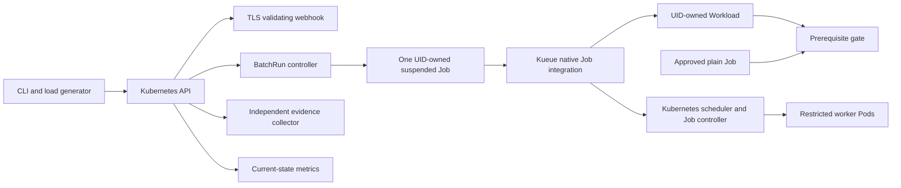

# Architecture

KubeFleet is a Kubernetes batch admission and lifecycle operator. It creates one
native suspended Job from an immutable BatchRun and projects actual API state.
Kueue owns quota allocation, borrowing, priority, preemption, admission and Job
suspension. The scheduler/kubelets own physical placement/execution; the Job
controller owns Pod retries and terminal conditions. The prerequisite gate supplies
one authorization check rather than a scheduler or workflow engine.

Controllers register indexes before startup: Workload→Job UID, BatchRun→local queue,
LocalQueue→ClusterQueue, named check and prerequisite Job name. Status-only Job,
Workload and Pod updates wake affected runs. Queue and prerequisite changes map
only relevant dependents; configuration changes map Workloads containing the named
check. Reconcile calls have bounded contexts and default concurrency four. Workqueue
rate limiting handles errors; ordinary status patches are skipped when semantically
unchanged. Deadline requeues remain even without external events.

The API is durable state. Materialization uses a SHA256-derived UID child name,
exact controller owner/identity verification and uncached reads after AlreadyExists.
Recorded Job disappearance yields JobLost rather than duplicate execution. Stop
intent is persisted before deletion; foreground cleanup confirms owned Pods are
gone and reservation is released before terminal cancellation/failure. Completion
and cancellation follow durable-observation precedence. See the fifteen ADRs.

The gate’s atomic Workload condition snapshot bridges Ready persistence and later
BatchRun projection. Named-check status updates preserve unrelated owners through
fresh resourceVersion preconditions. Registry/priority policy governs new submissions
and initial execution; an already latched prerequisite decision retains authorization
for the same run/reference after preemption or preparation cleanup.

Leader election protects controller writes. Every manager Pod serves the webhook;
a standby takes over through the Lease. Real tests kill after materialization, stop
intent, and Ready, and verify original UID recovery. Preemption replaces worker
Pods within the same logical Job and can lose application CPU work. There is no
checkpointing, external queue, arbitrary Pod template, multi-level DAG, application
retry orchestration, autoscaler or exactly-once application guarantee.
